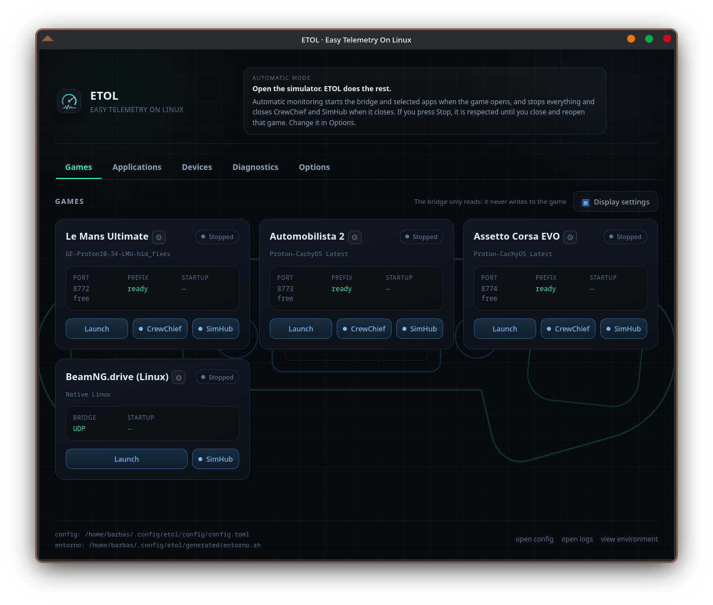
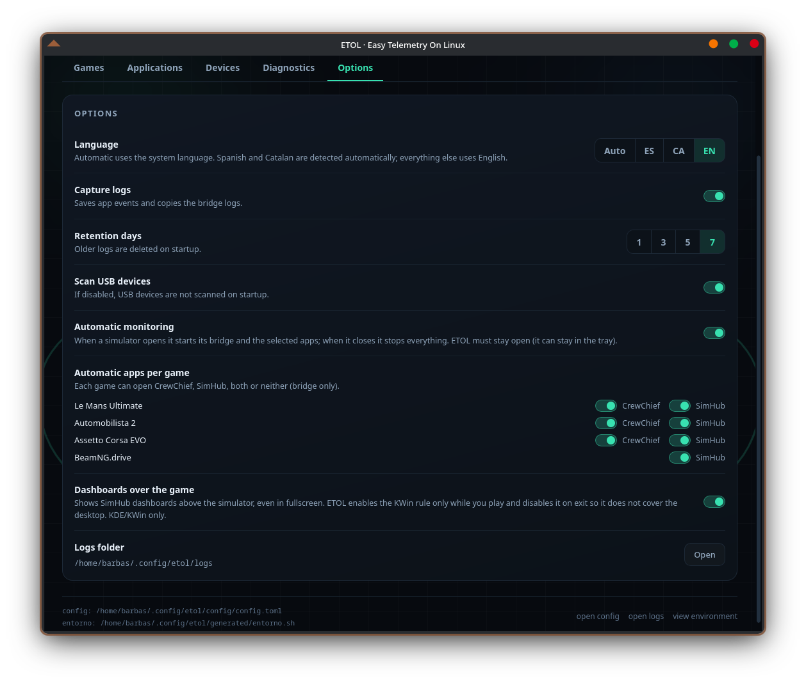

# ETOL · Easy Telemetry On Linux

[English](README.md) · **Español**

[](https://github.com/pabeernosmatao/ETOL-Easy-Telemetry-on-Linux/releases)
[](LICENSE)
[](#requisitos)
[](https://tauri.app)

**Telemetría para tus simuladores en Linux sin pelearte con Wine.**
ETOL detecta tus juegos, prepara SimHub (y CrewChief) y lo lanza todo con un clic.

---

## Qué hace

- **Detecta solo** los simuladores instalados en Steam (en cualquier biblioteca,
  también en otros discos), su Proton y la botella de Bottles con SimHub.
- **Autoconfigura cada juego** con un botón. El engranaje de la ficha se pone en
  **rojo** cuando ese juego aún no se ha configurado o ETOL ve algo mal.
- **Puente de telemetría por juego**: memoria compartida o UDP según lo que use
  cada simulador. Siempre de solo lectura: no escribe en el juego.
- **Vigilancia automática**: al abrir un simulador levanta el puente y las apps
  elegidas; al cerrarlo lo para todo. Si cambias de juego, cambia solo.
- **Pad HF8** (ForceFeel) con su COM dentro de la botella, listo para SimHub.
- **Dashboards de SimHub sobre el juego** en KDE/KWin, sin gamescope.
- Interfaz en **español, catalán e inglés**.

## Capturas



*Pestaña Juegos: una ficha por simulador. BeamNG.drive (Linux) muestra su puente UDP y solo el botón de SimHub.*



*Opciones: idioma, vigilancia automática, apps por juego y dashboards sobre el juego.*

## Desde cero: Bottles, SimHub y CrewChief

No hace falta tener Bottles ni SimHub instalados. ETOL prepara toda la pila:

1. **Instala Bottles** (Flatpak, para el usuario) si no está.
2. **Crea la botella `simhub`** con prefijo Windows 11 de 64 bits y un runner de
   Proton (lo descarga si hace falta).
3. **Prepara el prefijo** con las librerías que necesitan SimHub y CrewChief:
   `dotnet48`, `vcrun2019`, `vcrun2022`, `d3dcompiler_43`, `d3dx9` y
   `corefonts`, instaladas con winetricks.
4. **Descarga y abre los instaladores**: la última versión de CrewChief (MSI) y
   de SimHub (ZIP), e indica exactamente qué casillas dejar sin marcar.

Los dos instaladores son interactivos (son instaladores de Windows), así que se
pulsa «Siguiente» un par de veces; todo lo demás es automático.

## Simuladores soportados

| Juego | Telemetría | Apps | Notas |
|---|---|---|---|
| **Le Mans Ultimate** | memoria compartida | SimHub + CrewChief | |
| **Automobilista 2** | memoria compartida | SimHub + CrewChief | |
| **Assetto Corsa EVO** | memoria compartida | SimHub + CrewChief | |
| **Assetto Corsa** | memoria compartida | SimHub + CrewChief | |
| **rFactor 2** | memoria compartida | SimHub + CrewChief | incluye el plugin SMMP |
| **DiRT Rally 2.0** | UDP (relay 20777) | SimHub + CrewChief | `extradata=3` |
| **Euro Truck Simulator 2** | Linux nativo, `/dev/shm` | SimHub | instala el plugin SCS |
| **BeamNG.drive** | Linux nativo, OutGauge UDP | SimHub | |

## Hardware soportado

| Dispositivo | Tipo | Conexión | Qué hace ETOL |
|---|---|---|---|
| **HF8 / ForceFeel** | pad háptico | USB `04d8:ee96` | lo detecta, enlaza su puerto COM dentro de la botella de Bottles y escribe las claves de Windows que necesita SimHub |

Pendiente: soporte para **pedales DC2/DC3** (todavía no está implementado).

## Cómo se usa

1. **Detectar.** ETOL encuentra Steam, Bottles, SimHub y el pad HF8.
2. **Configurar.** Pulsa el engranaje de cada ficha (una vez por juego).
3. **Jugar.** Abre el simulador y pulsa **Lanzar**, o deja que la vigilancia
   automática lo haga al detectarlo.

## Instalación

Descarga el AppImage de la última release y dale permisos:

```bash
chmod +x ETOL-0.3.0-linux-x86_64-portable.AppImage
./ETOL-0.3.0-linux-x86_64-portable.AppImage
```

Hay dos variantes. Las dos son **x86_64** (`amd64` es solo el nombre que usa
Debian para la misma arquitectura); la diferencia es si llevan WebKit dentro:

| Variante | Tamaño | WebKit | glibc | Cuándo usarla |
|---|---|---|---|---|
| `ETOL-0.3.0-linux-x86_64-portable.AppImage` | ~6 MB | del sistema | 2.39+ | Ubuntu 26.04, Fedora, Arch, CachyOS. Necesita `libwebkit2gtk-4.1` |
| `ETOL-0.3.0-linux-x86_64-full.AppImage` | ~111 MB | incluido | 2.44+ | Todo dentro; rolling y escritorios actuales |

La variante portable necesita `libwebkit2gtk-4.1` y `libgtk-3`:

```bash
sudo apt install libwebkit2gtk-4.1-0 libgtk-3-0    # Ubuntu/Debian
sudo dnf install webkit2gtk4.1 gtk3                # Fedora
sudo pacman -S webkit2gtk-4.1 gtk3                 # Arch/CachyOS
```

Sin FUSE2:

```bash
./ETOL-0.3.0-linux-x86_64-portable.AppImage --appimage-extract-and-run
```

## Requisitos

- Linux x86_64 con **glibc 2.39 o superior**.
- **Steam** con los juegos instalados.
- **Bottles** (Flatpak o nativo) con una botella que tenga **SimHub**; CrewChief
  es opcional. ETOL puede instalar y preparar ambos (ver arriba).
- **KDE Plasma** si quieres los dashboards por encima del juego.
- El pad **HF8** es opcional.

## La ventana

- **Juegos**: una ficha por simulador con su estado, botones de apps y el
  engranaje de configuración.
- **Aplicaciones**: SimHub y CrewChief, con sus procesos.
- **Dispositivos**: el pad HF8 y el enlace de su puerto COM.
- **Diagnóstico**: comprobaciones con el arreglo exacto al lado.
- **Opciones**: idioma, vigilancia automática, dashboards, logs y USB.

## Documentación

- [`docs/TECNICO.md`](docs/TECNICO.md): CLI, configuración, detección, compilación.
- [`docs/guia-reinstalacion.html`](docs/guia-reinstalacion.html): reinstalar desde cero.
- [`THIRD-PARTY.md`](THIRD-PARTY.md): licencias de los componentes incluidos.

## Licencia

ETOL es MIT. El AppImage incluye componentes de terceros; ver
[THIRD-PARTY.md](THIRD-PARTY.md).
