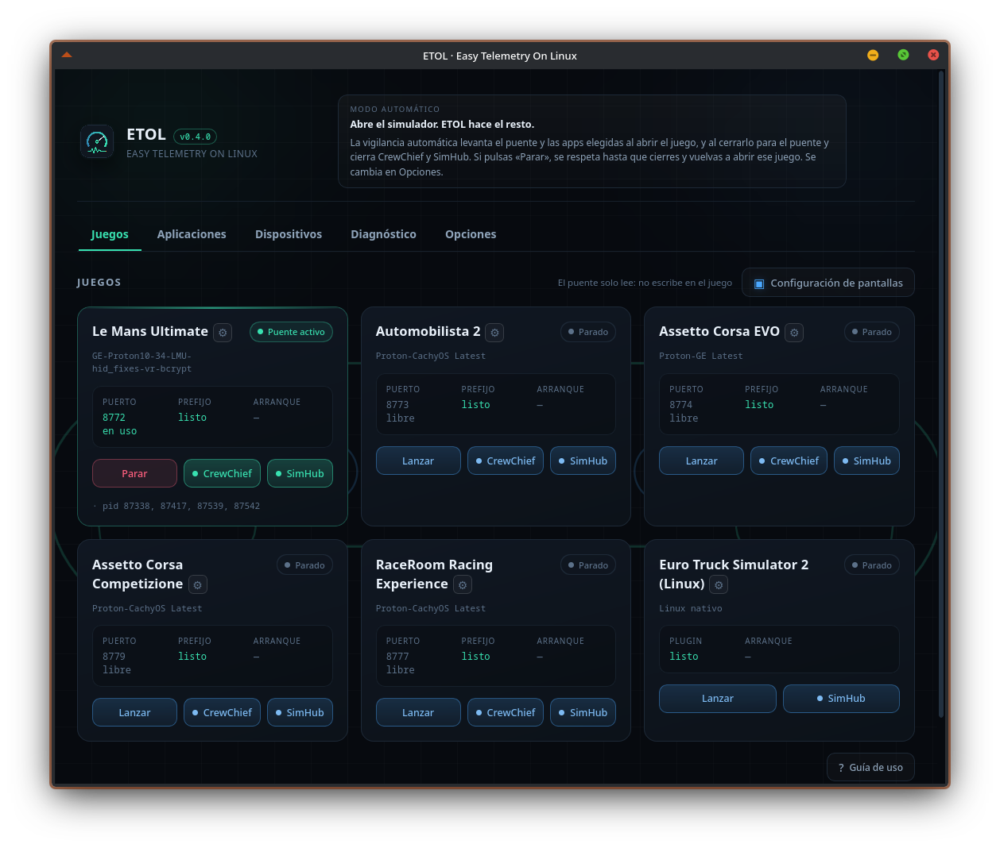
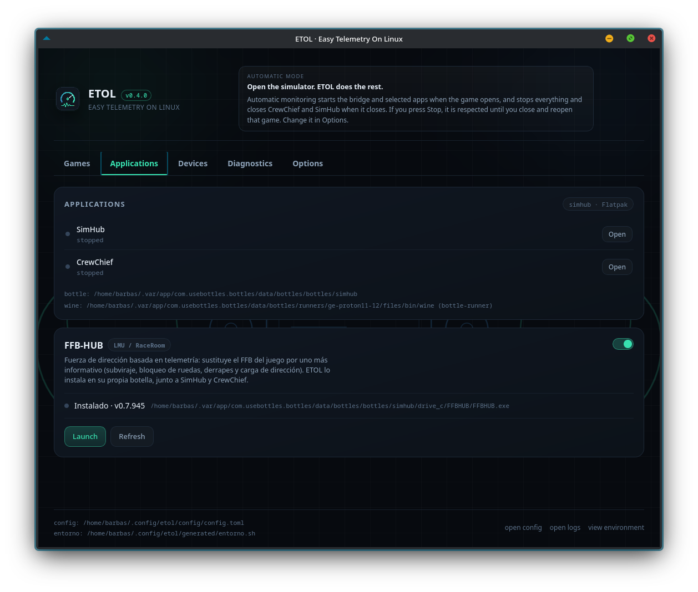
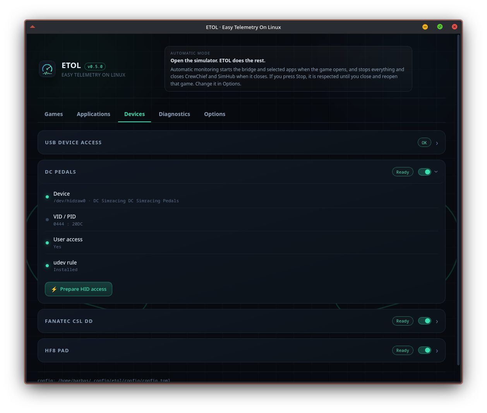
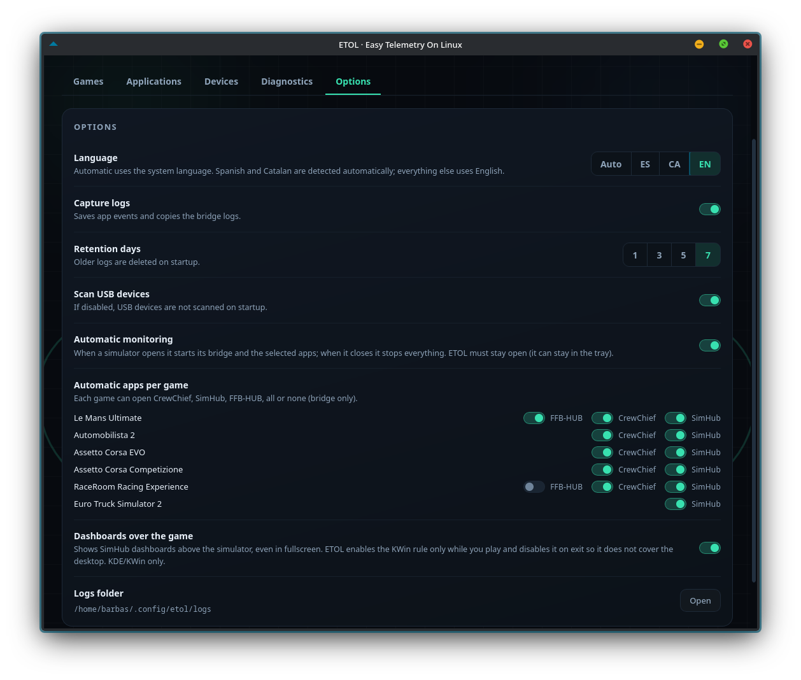

# ETOL · Easy Telemetry On Linux

[English](README.md) · **Español** · [Guía de uso](docs/GUIA.md)

[](https://github.com/pabeernosmatao/ETOL-Easy-Telemetry-on-Linux/releases)
[](LICENSE)
[](#requisitos)
[](https://tauri.app)

> **Proyecto personal — probado solo en mi equipo.**
>
> ETOL es un proyecto personal, no un producto comercial. Solo puedo
> desarrollarlo y probarlo con los simuladores, hardware y distribuciones Linux
> que tengo instalados. No puedo trabajar ni dar soporte para juegos,
> dispositivos o distribuciones que no tenga instalados. Otras configuraciones
> pueden funcionar, pero no puedo garantizarlo. Los informes y parches son
> bienvenidos, pero no puedo reproducir ni arreglar lo que no puedo ejecutar.

**Telemetría para tus simuladores en Linux sin pelearte con Wine.**
ETOL detecta tus juegos, prepara SimHub (y CrewChief) y lo lanza todo con un clic.

---

## Qué hace

- **Detecta solo** los simuladores instalados en Steam (en cualquier biblioteca,
  también en otros discos), su Proton y la botella de Bottles con SimHub.
- **Autoconfigura cada juego** con un botón. El engranaje de la ficha se pone en
  **rojo** cuando ese juego aún no se ha configurado o ETOL ve algo mal.
- **Puente de telemetría por juego**: memoria compartida o UDP según lo que use
  cada simulador. Siempre de solo lectura: no escribe en el juego.
- **Vigilancia automática**: al abrir un simulador levanta el puente y las apps
  elegidas; al cerrarlo lo para todo. Si cambias de juego, cambia solo.
- **Pad HF8** (ForceFeel) con su COM dentro de la botella, listo para SimHub.
- **FFB-HUB (LMUFFB)** opcional para LMU y RaceRoom: instala/actualiza el último
  release en la botella de ETOL y lo lanza a mano o con el juego.
- **DC Pedals (DC2/DC3)** app de calibración opcional: detecta el HID, prepara
  la regla udev e instala/lanza la utilidad oficial de DC Simracing en la
  botella de ETOL.
- **Fanatec CSL DD** configuración nativa opcional: lee y escribe el menú de
  tuning que expone `hid-fanatecff` (sin Wine, sin app oficial y sin firmware),
  con un perfil por juego instalado que se carga al arrancar el juego.
- **Sistemas Atomic (Bazzite) — beta**: detecta `rpm-ostree`, usa Bottles
  como Flatpak de sistema, normaliza las rutas `/var/home` y adapta los
  arreglos de USB/DC Pedals al diseño Atomic. Las distros clásicas siguen
  siendo el objetivo principal.
- **Dashboards por wifi**: el puerto 8888 solo se abre a tu red local. El
  diagnóstico puede comprobarlo y aplicar la regla LAN con un clic.
- **Arranque con el sistema**: **Opciones → Arrancar con el sistema** crea la
  entrada XDG y abre ETOL en la bandeja al iniciar sesión, sin ventana.
- **Dashboards de SimHub sobre el juego** en KDE/KWin, con o sin gamescope.
- Fichas desplegables que recuerdan su estado; interfaz en **español, catalán e
  inglés**.

## Capturas



*Pestaña Juegos: una ficha por simulador. BeamNG.drive (Linux) muestra su puente UDP y solo el botón de SimHub.*



*Pestaña Aplicaciones: SimHub y CrewChief, FFB-HUB, DC Pedals y los perfiles por juego del Fanatec CSL DD, con la botella de ETOL y las rutas.*



*Pestaña Dispositivos: acceso USB, DC Pedals, Fanatec CSL DD y HF8, con sus interruptores y etiquetas de estado.*



*Opciones: arranque con el sistema, idioma, vigilancia automática, apps por juego y dashboards sobre el juego.*

## Desde cero: Bottles, SimHub y CrewChief

No hace falta tener Bottles ni SimHub instalados. ETOL prepara toda la pila:

1. **Instala Bottles** (Flatpak, para el usuario) si no está.
2. **Crea la botella `simhub`** con prefijo Windows 11 de 64 bits y un runner de
   Proton (lo descarga si hace falta).
3. **Prepara el prefijo** con las librerías que necesitan SimHub y CrewChief:
   `dotnet48`, `vcrun2022`, `d3dcompiler_43`, `d3dx9` y
   `corefonts`, instaladas con winetricks.
4. **Descarga y abre los instaladores**: la última versión de CrewChief (MSI) y
   de SimHub (ZIP), e indica exactamente qué casillas dejar sin marcar.

Los dos instaladores son interactivos (son instaladores de Windows), así que se
pulsa «Siguiente» un par de veces; todo lo demás es automático.

## Simuladores soportados

| Juego | Telemetría | Apps | Notas |
|---|---|---|---|
| **Le Mans Ultimate** | memoria compartida | SimHub + CrewChief (+ FFB-HUB) | |
| **Automobilista 2** | memoria compartida | SimHub + CrewChief | |
| **Assetto Corsa EVO** | memoria compartida | SimHub + CrewChief | |
| **Assetto Corsa** | memoria compartida | SimHub + CrewChief | |
| **Assetto Corsa Competizione** | memoria compartida | SimHub + CrewChief | |
| **rFactor 2** | memoria compartida | SimHub + CrewChief | incluye el plugin SMMP |
| **RaceRoom Racing Experience** | memoria compartida (`$R3E`) | SimHub + CrewChief (+ FFB-HUB) | espejo crudo por UDP 8777 |
| **DiRT Rally 2.0** | UDP (relay 20777) | SimHub + CrewChief | `extradata=3` |
| **Euro Truck Simulator 2** | Linux nativo, `/dev/shm` | SimHub | instala el plugin SCS |
| **BeamNG.drive** | Linux nativo, OutGauge UDP | SimHub | |

## Hardware soportado

| Dispositivo | Tipo | Conexión | Qué hace ETOL |
|---|---|---|---|
| **HF8 / ForceFeel** | pad háptico | USB `04d8:ee96` | lo detecta, enlaza su puerto COM dentro de la botella de Bottles y escribe las claves de Windows que necesita SimHub |
| **DC Pedals (DC2/DC3)** | pedales | USB HID `0444:20DC` | instala la utilidad oficial de calibración de DC Simracing, prepara la regla udev y corrige el camino HID de Wine. La utilidad solo escribe en los pedales al pulsar **Enviar configuración** |
| **Fanatec CSL DD** | base | USB HID `0eb7:0020` | tuning nativo con `hid-fanatecff` (fanatec-dkms): perfiles por juego, deslizables en Aplicaciones e interruptor en Dispositivos. Sin firmware |

Otras bases Fanatec compatibles con `hid-fanatecff` usan la misma ficha. DC
Pedals y Fanatec son opcionales y están desactivados hasta que los actives.

## Cómo se usa

1. **Detectar.** ETOL encuentra Steam, Bottles, SimHub y los dispositivos USB.
2. **Configurar.** Pulsa el engranaje de cada ficha (una vez por juego).
3. **Jugar.** Abre el simulador y pulsa **Lanzar**, o deja que la vigilancia
   automática lo haga al detectarlo.
4. **Hardware (opcional).** Activa DC Pedals y Fanatec en **Dispositivos** y
   prepara su acceso. Para Fanatec, edita un perfil por juego en
   **Aplicaciones → Fanatec CSL DD**; ETOL lo aplica al arrancar el juego.

## Instalación

Descarga el AppImage de la última release y dale permisos:

```bash
chmod +x ETOL-0.5.2-linux-x86_64-portable.AppImage
./ETOL-0.5.2-linux-x86_64-portable.AppImage
```

Hay dos variantes. Las dos son **x86_64** (`amd64` es solo el nombre que usa
Debian para la misma arquitectura); la diferencia es si llevan WebKit dentro:

| Variante | Tamaño | WebKit | glibc | Cuándo usarla |
|---|---|---|---|---|
| `ETOL-0.5.2-linux-x86_64-portable.AppImage` | ~6 MB | del sistema | 2.39+ | Ubuntu 26.04, Fedora, Arch, CachyOS. Necesita `libwebkit2gtk-4.1` |
| `ETOL-0.5.2-linux-x86_64-full.AppImage` | ~111 MB | incluido | 2.44+ | Todo dentro; rolling y escritorios actuales |

La variante portable necesita `libwebkit2gtk-4.1` y `libgtk-3`:

```bash
sudo apt install libwebkit2gtk-4.1-0 libgtk-3-0    # Ubuntu/Debian
sudo dnf install webkit2gtk4.1 gtk3                # Fedora
sudo pacman -S webkit2gtk-4.1 gtk3                 # Arch/CachyOS
```

Sin FUSE2:

```bash
./ETOL-0.5.2-linux-x86_64-portable.AppImage --appimage-extract-and-run
```

## Requisitos

### Siempre necesarios

- Linux x86_64 con **glibc 2.39 o superior**.
- `python3` (los puentes de telemetría) y `curl` (descarga los instaladores).
- **Steam** con los juegos instalados.
- **Bottles** (Flatpak o nativo) con una botella que tenga **SimHub**; CrewChief
  es opcional. ETOL puede instalar y preparar ambos (ver arriba).

### Solo si usas ese hardware o función

- **KDE Plasma** si quieres los dashboards por encima del juego. Sin él ETOL
  funciona igual; simplemente no tienes el overlay.
- Un escritorio con soporte de **StatusNotifierItem** para el icono de bandeja
  (Plasma, una barra de niri con módulo de bandeja, o GNOME con la extensión
  AppIndicator). Sin él ETOL funciona igual, solo falta el icono.
- **Pad HF8**: no necesita paquetes extra; ETOL lo detecta. `pkexec` solo hace
  falta para la regla opcional de acceso USB.
- **DC Pedals**: un extractor (`bsdtar`/`7z`/`unrar`) para el RAR oficial y
  `pkexec` para la regla udev. ETOL instala el extractor correcto si no hay
  ninguno.
- **Fanatec CSL DD**: el driver **`hid-fanatecff`** (empaquetado como
  **fanatec-dkms**) debe estar cargado, y `pkexec` se usa para la regla de
  escritura. Sin el driver ETOL funciona igual; la ficha Fanatec simplemente no
  está disponible.
- **Puerto 8888 / dashboards por wifi**: `ufw` o `firewalld` solo para el botón
  **Abrir puerto 8888**.

`pkexec` y un agente polkit solo se usan en las acciones que cambian permisos
del sistema (reglas udev y firewall). Nada de esta segunda lista hace falta para
abrir ETOL, detectar juegos o ejecutar los puentes de telemetría.

En sistemas Atomic (Bazzite) ETOL detecta `rpm-ostree`, usa
`rpm-ostree install --apply-live` para los paquetes que falten y acepta Bottles
como Flatpak de sistema. La ficha **Opciones → Entorno detectado** muestra el
resultado y permite volver a detectarlo tras una actualización. **El soporte
Atomic está en beta**; las distros clásicas son el objetivo principal.

## La ventana

- **Juegos**: una ficha por simulador con su estado, botones de apps y el
  engranaje de configuración.
- **Aplicaciones**: SimHub y CrewChief, FFB-HUB, DC Pedals y la ficha del
  Fanatec CSL DD con un desplegable por juego instalado.
- **Dispositivos**: acceso USB, DC Pedals, Fanatec CSL DD y el pad HF8, con sus
  interruptores y etiquetas de estado.
- **Diagnóstico**: comprobaciones con el arreglo exacto al lado, incluida la
  comprobación del puerto 8888 y el botón **Abrir puerto 8888** solo para la LAN.
- **Opciones**: arranque con el sistema, idioma, vigilancia automática, dashboards, logs y USB.

## Compatibilidad por escritorio

Todo excepto el overlay y el icono de bandeja funciona en cualquier escritorio:

| Función | KDE Plasma | GNOME | niri / otros Wayland |
|---|---|---|---|
| App, detección, puentes, SimHub/CrewChief | Sí | Sí | Sí |
| Dashboards sobre el juego | **Sí** (regla de KWin, sin gamescope) | No | No |
| Icono de bandeja | Nativo | Con la extensión AppIndicator | Con una barra que tenga bandeja |
| Cerrar a la bandeja | Sí | Con la extensión | Con la barra |

El overlay es una regla de KWin que coloca la ventana de SimHub encima del
simulador. En Plasma funciona **con o sin gamescope**; no es necesario usar
gamescope. GNOME y niri no implementan esa regla, así que allí ETOL ofrece
telemetría y apps, pero no el overlay.

## Documentación

- [`docs/TECNICO.md`](docs/TECNICO.md): CLI, configuración, detección, compilación.
- [`docs/GUIA.md`](docs/GUIA.md): guía de uso completa (Markdown).
- [`docs/guia-es.html`](docs/guia-es.html): la misma guía en HTML.
- [`THIRD-PARTY.md`](THIRD-PARTY.md): licencias de los componentes incluidos.

## Contribuir

Los informes de fallos, propuestas y pull requests son bienvenidos. Lee antes
[CONTRIBUTING.md](CONTRIBUTING.md). ETOL es un proyecto personal y solo puedo
probar lo que tengo instalado; las issues y PRs se pueden escribir en inglés o
español.

## Licencia

ETOL es MIT. El AppImage incluye componentes de terceros; ver
[THIRD-PARTY.md](THIRD-PARTY.md).
