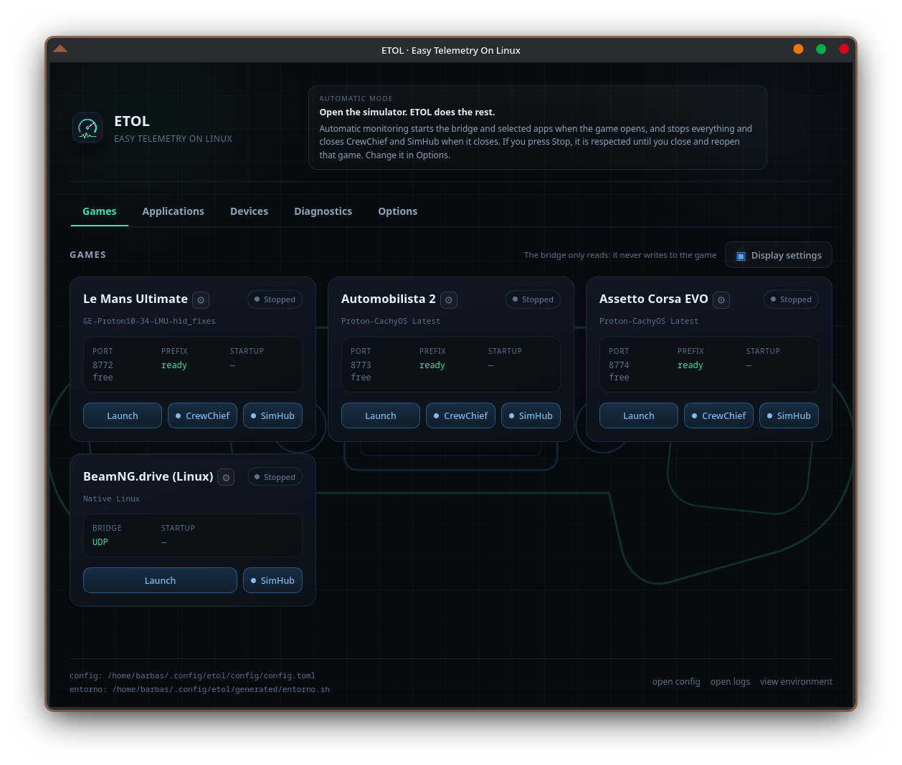
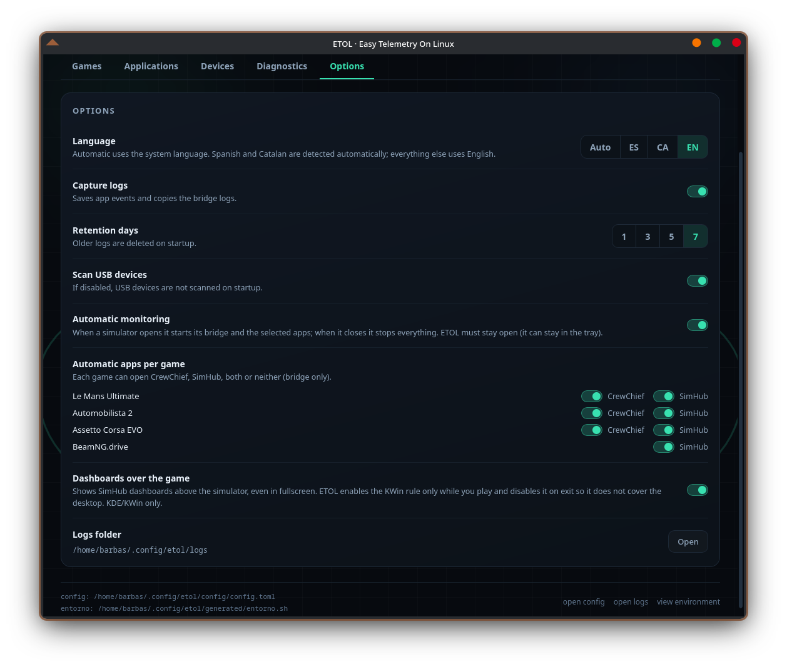

# ETOL · Easy Telemetry On Linux

**English** · [Español](README.es.md) · [User guide](docs/GUIDE.md)

[](https://github.com/pabeernosmatao/ETOL-Easy-Telemetry-on-Linux/releases)
[](LICENSE)
[](#requirements)
[](https://tauri.app)

> **Personal project — tested only on my own setup.**
>
> ETOL is a personal project, not a commercial product. I can only develop and
> test it with the simulators, hardware and Linux distributions installed on my
> own machine. I cannot work on or support games, devices or distributions I do
> not have installed. Other setups may work, but I cannot guarantee them. Bug
> reports and patches are welcome, but I cannot reproduce or fix what I cannot
> run.

**Telemetry for your simulators on Linux without fighting Wine.**
ETOL detects your games, sets up SimHub (and CrewChief) and launches everything
with one click.

---

## What it does

- **Auto-detects** your Steam simulators (any library, any disk), their Proton
  build and the Bottles bottle with SimHub.
- **Per-game auto-configuration** with one button. The gear turns **red** when a
  game has never been configured or ETOL finds something wrong.
- **Per-game telemetry bridge**: shared memory or UDP, whichever the simulator
  uses. Always read-only: it never writes into the game.
- **Automatic watchdog**: opening a simulator starts its bridge and apps;
  closing it stops everything. Switching games switches everything.
- **HF8 pad** (ForceFeel) with its COM port wired inside the bottle.
- **SimHub dashboards over the game** on KDE/KWin, no gamescope needed.
- Interface in **Spanish, Catalan and English**.

## Screenshots



*Games tab: one card per simulator. BeamNG.drive (Linux) shows its UDP bridge and only the SimHub button.*



*Options: language, automatic monitoring, per-game apps and dashboards over the game.*

## From scratch: Bottles, SimHub and CrewChief

You do not need Bottles or SimHub installed beforehand. ETOL prepares the whole
stack:

1. **Installs Bottles** (Flatpak, per user) if it is missing.
2. **Creates the `simhub` bottle** with a 64-bit Windows 11 prefix and a Proton
   runner (it downloads the runner if needed).
3. **Prepares the prefix** with the libraries SimHub and CrewChief need:
   `dotnet48`, `vcrun2022`, `d3dcompiler_43`, `d3dx9` and
   `corefonts`, installed through winetricks.
4. **Downloads and opens the installers**: the latest CrewChief (MSI) and
   SimHub (ZIP), and tells you exactly which boxes to leave unchecked.

The two installers are interactive (they are Windows installers), so you click
"Next" twice; everything around them is automated.

## Supported simulators

| Game | Telemetry | Apps | Notes |
|---|---|---|---|
| **Le Mans Ultimate** | shared memory | SimHub + CrewChief | |
| **Automobilista 2** | shared memory | SimHub + CrewChief | |
| **Assetto Corsa EVO** | shared memory | SimHub + CrewChief | |
| **Assetto Corsa** | shared memory | SimHub + CrewChief | |
| **rFactor 2** | shared memory | SimHub + CrewChief | bundles the SMMP plugin |
| **RaceRoom Racing Experience** | shared memory (`$R3E`) | SimHub + CrewChief | raw mirror over UDP 8777 |
| **DiRT Rally 2.0** | UDP relay (20777) | SimHub + CrewChief | `extradata=3` |
| **Euro Truck Simulator 2** | native Linux, `/dev/shm` | SimHub | installs the SCS plugin |
| **BeamNG.drive** | native Linux, OutGauge UDP | SimHub | |

## Supported hardware

| Device | Type | Connection | What ETOL does |
|---|---|---|---|
| **HF8 / ForceFeel** | haptic pad | USB `04d8:ee96` | detects it, links its COM port inside the Bottles bottle and writes the Windows keys SimHub needs |

Planned: support for **DC2/DC3 pedals** (not implemented yet).

## How to use it

1. **Detect.** ETOL finds Steam, Bottles, SimHub and the HF8 pad.
2. **Configure.** Press the gear on each card (once per game).
3. **Play.** Open the simulator and press **Launch**, or let the automatic
   watchdog do it when it sees the game.

## Installation

Download the AppImage from the latest release and make it executable:

```bash
chmod +x ETOL-0.3.23-linux-x86_64-portable.AppImage
./ETOL-0.3.23-linux-x86_64-portable.AppImage
```

Two builds are published. Both are **x86_64** (`amd64` is just Debian's name
for the same architecture); the difference is whether WebKit is bundled:

| Build | Size | WebKit | glibc | When to use |
|---|---|---|---|---|
| `ETOL-0.3.23-linux-x86_64-portable.AppImage` | ~6 MB | system | 2.39+ | Ubuntu 26.04, Fedora, Arch, CachyOS. Needs `libwebkit2gtk-4.1` |
| `ETOL-0.3.23-linux-x86_64-full.AppImage` | ~111 MB | bundled | 2.44+ | Everything included; current rolling and desktop distros |

The portable build needs `libwebkit2gtk-4.1` and `libgtk-3`:

```bash
sudo apt install libwebkit2gtk-4.1-0 libgtk-3-0    # Ubuntu/Debian
sudo dnf install webkit2gtk4.1 gtk3                # Fedora
sudo pacman -S webkit2gtk-4.1 gtk3                 # Arch/CachyOS
```

Without FUSE2:

```bash
./ETOL-0.3.23-linux-x86_64-portable.AppImage --appimage-extract-and-run
```

## Requirements

- Linux x86_64 with **glibc 2.39 or newer**.
- `python3` (the telemetry bridges) and `curl` (downloads the installers).
- **Steam** with the games installed.
- **Bottles** (Flatpak or native) with a bottle that has **SimHub**; CrewChief
  is optional. ETOL can install and prepare both (see above).
- **KDE Plasma** for dashboards above the game.
- The **HF8** pad is optional.
- A desktop with **StatusNotifierItem** support for the tray icon (Plasma, a
  niri bar with a tray module, or GNOME with the AppIndicator extension).
  Without it ETOL works the same, only the tray icon is missing.

## The window

- **Games**: one card per simulator with its status, app buttons and the
  configuration gear.
- **Applications**: SimHub and CrewChief with their processes.
- **Devices**: the HF8 pad and its COM link.
- **Diagnostics**: checks with the exact fix next to them.
- **Options**: language, automatic watchdog, dashboards, logs and USB.

## Desktop support

Everything except the overlay and the tray icon works on any desktop:

| Feature | KDE Plasma | GNOME | niri / other Wayland |
|---|---|---|---|
| App, detection, bridges, SimHub/CrewChief | Yes | Yes | Yes |
| Dashboards over the game | **Yes** (KWin rule, no gamescope) | No | No |
| Tray icon | Native | With the AppIndicator extension | With a bar that has a tray module |
| Close to tray | Yes | With the extension | With the bar |

The overlay is a KWin rule that places the SimHub window above the simulator.
On Plasma it works **with or without gamescope**; gamescope is not required.
GNOME and niri do not implement that rule, so there ETOL provides telemetry and
apps but no overlay.

## Documentation

- [`docs/TECNICO.md`](docs/TECNICO.md): CLI, configuration, detection, building.
- [`docs/GUIDE.md`](docs/GUIDE.md): user guide (Markdown, English).
- [`docs/guia-en.html`](docs/guia-en.html): the same guide as HTML.
- [`THIRD-PARTY.md`](THIRD-PARTY.md): licenses of the bundled components.

## Contributing

Bug reports, feature requests and pull requests are welcome. Read
[CONTRIBUTING.md](CONTRIBUTING.md) first. ETOL is a personal project and I can
only test what I have installed; issues and PRs can be written in English or
Spanish.

## License

ETOL is MIT. The AppImage bundles third-party components; see
[THIRD-PARTY.md](THIRD-PARTY.md).
