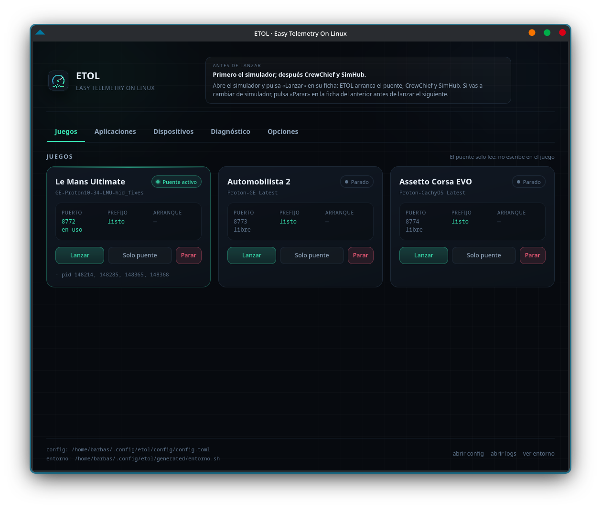

# ETOL · Easy Telemetry On Linux

Detector, configurador y lanzador de la pila de telemetría para simuladores en
Linux. Nació para dejar de editar rutas a mano en los scripts de
`SIMHUB_LINUX` y para tener un único sitio donde consultar el estado real de
todo (juegos, Proton, prefijos, SimHub, CrewChief y el pad HF8).

Todo vive dentro de esta carpeta: configuración, entorno generado, toolchain y
el AppImage final.



## Estado (v0.2.0)

Funciona y está probado en este equipo:

- Detecta **Le Mans Ultimate**, **Automobilista 2**, **Assetto Corsa EVO**,
  **Assetto Corsa**, **rFactor 2**, **DiRT Rally 2.0** y **Euro Truck
  Simulator 2** en cualquier biblioteca de Steam, incluidas las de otros discos.
- Usa un puente de memoria compartida para los simuladores que lo publican y un
  **relay UDP** para DiRT Rally 2.0 (juego → 20777 → SimHub/CrewChief), con
  `extradata=3` y un stub `dirtrally2.exe` para que CrewChief lo detecte.
- **Euro Truck Simulator 2** va en su **versión nativa de Linux**: instala el
  plugin SCS (`libscs-telemetry.so`) en `bin/linux_x64/plugins` y un espejo
  copia `/dev/shm/SCSTelemetry` a la memoria con nombre del prefijo de Bottles.
  Solo SimHub: CrewChief no tiene lector de camiones.
- Resuelve la **versión de Proton** real de cada juego, incluso cuando Steam
  anota un nombre de build que no coincide con la carpeta.
- Encuentra la **botella de Bottles** con SimHub y CrewChief y el `wine` de su
  runner.
- Detecta el **HF8** (`04d8:ee96`) y comprueba si `COM33` apunta al dispositivo
  correcto.
- Genera `generated/entorno.sh` con todas las rutas.
- **Incluye los scripts y el puente dentro del AppImage** y los instala en
  `~/.config/etol/payload` en el primer arranque.
- Lanza los scripts existentes con el entorno ya resuelto.
- `doctor` revisa la instalación y propone el comando exacto para cada arreglo.
- Tiene **interfaz gráfica** (Tauri) y se empaqueta como **AppImage**.

## Requisitos

- Linux con `bash`.
- Steam y/o Bottles instalados en las rutas habituales.
- Para compilar el núcleo: el toolchain local que instala este proyecto.
- Para compilar la interfaz: `webkit2gtk-4.1`, `gtk3`, `librsvg` y Node/npm.
- Para ejecutar el AppImage: `fuse2`. En Ubuntu LTS: `sudo apt install libfuse2`
  (o ejecuta el AppImage con `--appimage-extract-and-run`, que no necesita FUSE).
- El AppImage ya incluye los scripts del puente; no hace falta copiar
  `SIMHUB_LINUX` para usarlo.

No hace falta `sudo`, ni Rust del sistema, ni tocar `~/.cargo`.

## Instalar el toolchain

```bash
./scripts/instalar-toolchain.sh
```

Descarga Rust (perfil mínimo) en `.toolchain/`. Para borrarlo:
`rm -rf .toolchain`.

## Compilar

```bash
./scripts/cargo.sh build --release   # CLI en target/release/etol
./scripts/gui.sh build               # AppImage en target/release/bundle/appimage/
```

`gui.sh build` ejecuta antes `scripts/preparar-payload.sh`, que copia
`Simhub_Linux_APP` a `src-tauri/payload`. Si la carpeta no está en las rutas
habituales, indícala con `ETOL_APP_DIR=/ruta/Simhub_Linux_APP`.

## CLI incluida

El AppImage lleva el CLI en `usr/bin/etol`, así que no hay que instalar
nada aparte. Desde la terminal:

```bash
./ETOL_0.2.0_amd64.AppImage --appimage-extract
./squashfs-root/usr/bin/etol --version
./squashfs-root/usr/bin/etol doctor
```

O, si ya está extraído/instalado:

```bash
etol --version
etol detect --save
etol doctor
```

`etol doctor` usa tres niveles:

- **FALLO**: payload ausente, botella configurada que ya no existe, wine
  configurado a mano que no existe o puerto UDP ocupado. Solo los FALLO hacen
  que el comando termine con código distinto de cero.
- **AVISO**: juegos no instalados, HF8 desconectado (es hardware opcional), wine
  resuelto por fallback del sistema, locks huérfanos, etc.
- **OK**: todo correcto.

El origen del wine queda registrado en `apps.wine_source`
(`bottle-runner`, `compat-tool`, `system` o `manual`) y se muestra tanto en el
doctor como en la interfaz.

## Interfaz gráfica

```bash
./scripts/gui.sh          # compila en debug y abre la ventana
./scripts/gui.sh dev      # modo desarrollo de Tauri
./scripts/gui.sh build    # AppImage listo para usar
```

Desde un clon limpio del repositorio:

```bash
./scripts/instalar-toolchain.sh   # Rust aislado en .toolchain/ (una vez)
npm install                       # CLI de Tauri (una vez)
./scripts/gui.sh build            # AppImage en target/release/bundle/appimage/
```

El repositorio incluye una copia ya generada del payload en
`src-tauri/payload/`, así que compila sin necesidad del árbol original de
`SIMHUB_LINUX`. Si tienes ese árbol, `preparar-payload.sh` la regenera.

El AppImage queda en:

```
target/release/bundle/appimage/ETOL_0.3.0_amd64.AppImage
```

Es un binario único de ~111 MB (lleva WebKitGTK y el payload dentro). Se ejecuta
con doble clic o desde la terminal:

```bash
./target/release/bundle/appimage/ETOL_0.3.0_amd64.AppImage
```

### Variante portable (`-linux-x86_64`)

El AppImage completo empaqueta el WebKit y el GTK de la maquina donde se
compila. Si esa maquina es mas nueva que el destino, el binario exige una glibc
que el destino no tiene (por ejemplo, compilado en CachyOS con glibc 2.44 no
arranca en Ubuntu 26.04, que trae 2.43).

Para esos casos hay una variante que usa el WebKit del sistema y solo pide
glibc 2.39:

```bash
./scripts/empaquetar-portable.sh
# target/release/bundle/appimage/ETOL-0.3.0-linux-x86_64.AppImage  (~6 MB)
```

Requiere en el sistema `libwebkit2gtk-4.1` y `libgtk-3`:

```bash
sudo apt install libwebkit2gtk-4.1-0 libgtk-3-0      # Ubuntu/Debian
sudo dnf install webkit2gtk4.1 gtk3                  # Fedora
sudo pacman -S webkit2gtk-4.1 gtk3                   # Arch/CachyOS
```

Si el sistema no tiene FUSE2:

```bash
./ETOL-0.3.0-linux-x86_64.AppImage --appimage-extract-and-run
```

> **¿Vas a reinstalar el sistema o moverlo a otro equipo?** El AppImage ya lleva
> el panel, los scripts y el puente: en el primer arranque los instala en
> `~/.config/etol/payload`. Solo necesitas la base (Steam, juegos, Proton
> y Bottles con SimHub y CrewChief). La
> [guía de reinstalación](docs/guia-reinstalacion.html) lo explica paso a paso,
> incluido qué hacer con scripts personalizados.

### Scripts incluidos

El AppImage empaqueta `Simhub_Linux_APP` (scripts, `bridge/*.exe`,
`setup_hf8.sh` y el configurador de apps) y lo instala la primera vez:

```
~/.config/etol/payload/
├── arrancar_todo_lmu.sh
├── activar_puente_lmu.sh
├── desactivar_puente_lmu.sh
├── bridge/
│   ├── lmu_shm_mirror.exe
│   ├── setup_hf8.sh
│   └── ...
└── ...
```

- Se copia con permisos de ejecución y se apunta `bridge.app_dir` ahí.
- Cada build lleva un identificador de contenido (`.payload-id`); si cambia, la
  app refresca la copia al arrancar.
- Si una versión anterior dejó `bridge.app_dir` apuntando a la ruta histórica
  `SIMHUB_LINUX`, el primer arranque la migra al payload (la carpeta original no
  se toca).
- Si ya tienes `SIMHUB_LINUX` y quieres usar tu versión, arranca con
  `ETOL_APP_DIR=~/Escritorio/SIMHUB_LINUX/Simhub_Linux_APP`. La app
  respeta esa ruta y no instala el payload.
- No edites `payload/` si quieres conservar cambios: una actualización del
  AppImage lo reemplaza.

El payload se genera al compilar con `scripts/preparar-payload.sh`, que copia
`Simhub_Linux_APP` sin `.pdb`, `.cpp` ni `__pycache__` (unos 3,2 MB).

### Qué hace la ventana

La ventana se organiza en pestañas: **Juegos** (la principal),
**Aplicaciones**, **Dispositivos**, **Diagnóstico** y **Opciones**.

- **Juegos**: una tarjeta por simulador con su Proton, el estado del prefijo,
  el puerto y el lock de arranque. Botones `CrewChief` y `SimHub` (abren o
  cierran solo esa app, en verde si está parada y en rojo si funciona) y
  `Lanzar`/`Parar`: `Parar` detiene el puente **y además cierra SimHub y
  CrewChief**. El engranaje de cada ficha aplica su configuración sin arrancar
  el puente.
- **Aplicaciones**: estado de SimHub y CrewChief y botón para abrirlos por
  separado dentro de la botella (no los reinicia si ya están en marcha).
- **Dispositivos**: el pad HF8, a qué apunta `COM33`, qué proceso lo tiene
  abierto y botón para reconfigurarlo. Si en Opciones se desactiva la búsqueda
  USB, esta pestaña lo indica y no se escanea nada.
- **Diagnóstico**: las mismas comprobaciones que `etol doctor`, con el
  comando sugerido en cada aviso y limpieza de locks huérfanos. Incluye el
  puerto **8888** de SimHub y el estado del firewall (ufw/firewalld).
- **Opciones**: activar/desactivar la captura de logs, elegir retención
  (1, 3, 5 o 7 días), desactivar la búsqueda de dispositivos USB y activar la
  **vigilancia automática**: mientras ETOL esté abierto (aunque esté en la
  bandeja), al abrir un simulador levanta su puente y las apps elegidas por
  juego (CrewChief, SimHub, ambas o ninguna) y al cerrarlo para el puente y
  cierra las apps. Un `Parar` manual se respeta hasta que el juego se cierre y
  vuelva a abrirse.
- **Idioma**: ETOL detecta el idioma del sistema (español, catalán o inglés)
  y permite fijarlo en `Auto`, `ES`, `CA` o `EN` desde Opciones. La interfaz,
  MESSAGES y las comprobaciones del Diagnóstico cambian de idioma.
- El estado se refresca solo cada 4 segundos.

Los logs se guardan en `<raíz>/logs` (en el AppImage,
`~/.config/etol/logs`). La app escribe un `etol-AAAA-MM-DD.log`
y copia los logs del puente en `run-AAAA-MM-DD/`.

### Overlays y dashboards de SimHub

SimHub muestra los dashboards en ventanas X11. Si el simulador está a pantalla
completa, KWin las coloca por debajo y el dashboard no se ve.

ETOL lo resuelve con una **regla de KWin** que fuerza esos dashboards a la capa
**Overlay** (por encima de fullscreen, también con juegos Wayland). La regla se
activa solo mientras hay un simulador en marcha y se desactiva al cerrarlo, para
que no tapen el escritorio. Se controla con **Opciones → Dashboards sobre el
juego** (activado por defecto).

El botón **Configuración de pantallas** de la pestaña Juegos genera la línea de
lanzamiento para Steam con:

- **Gamescope** o **sin gamescope**.
- **1 o 3 pantallas** y resolución **1080p / 1440p / 4K**.
- Extras por GPU: captura del ratón, MangoHud, FSR/NIS, FSR 4, DLSS, caché de
  shaders, etc.

Con gamescope usa siempre `-b` y **nunca** `-f`. Sin gamescope, la resolución y
el triple se configuran en el juego; ETOL mantiene los dashboards encima con la
regla de KWin. ETOL detecta el juego igualmente y el puente, SimHub, CrewChief y
el HF8 no cambian.

La regla se puede crear a mano en KDE si se prefiere: título
`.*\(WPF Renderer\)$`, clase `steam_proton`, propiedad **Layer = Overlay** y
**Force**.

### Enlaces de Steam en la botella

Al detectar un juego, la app crea dentro de la botella:

```
Program Files (x86)/Steam/steamapps/common/<juego> -> <instalación real>
```

Así SimHub y CrewChief encuentran juegos de cualquier biblioteca o disco. Si
ya existía el enlace manual `steam -> ~/.local/share/Steam`, se guarda como
`steam.enlace-<fecha>` y se sustituye por una carpeta gestionada con un enlace
por juego. El doctor muestra si faltan enlaces.

Los procesos se lanzan con `setsid`: cerrar la ventana no para el puente ni las
aplicaciones.

### Icono en la bandeja

Al cerrar la ventana, la aplicación se oculta en la bandeja del sistema en vez
de terminar. El menú del icono tiene:

- **Mostrar ventana**.
- Un submenú por juego (`Le Mans Ultimate`, `Automobilista 2`, `Assetto Corsa
  EVO`) con **Lanzar** y **Parar**.
- **Salir**, que para cualquier puente abierto y cierra SimHub y CrewChief
  antes de terminar.

`Lanzar` y `Parar` desde la bandeja hacen exactamente lo mismo que los botones
de la ventana: `Parar` detiene el puente y cierra SimHub y CrewChief.

La bandeja usa StatusNotifier/AppIndicator (KDE Plasma, GNOME con extensión,
etc.). Si el escritorio no la soporta, la aplicación avisa por consola y cerrar
la ventana termina el programa como antes.

### Avisos de la zona MESSAGES

La esquina superior derecha de la ventana es la zona **MESSAGES**. Por defecto
recuerda el orden correcto: abrir el simulador, pulsar «Lanzar» en su ficha y,
si se cambia de simulador, pulsar antes «Parar» en la ficha del anterior.

Ese aviso se sustituye por uno importante cuando ETOL detecta un problema:

| Aviso | Qué ofrece |
|---|---|
| Falta Bottles Flatpak | Instalarlo en modo usuario y aplicar los permisos mínimos. |
| Bottles en modo sistema | Instalar la copia de usuario (la de sistema no se toca) y aplicar permisos. |
| Faltan permisos | `home`, `host-etc`, las bibliotecas de Steam de otros discos y `devices=all` para el HF8. |
| Falta la botella | Descargar GE-Proton, crear la botella `simhub`, instalar dependencias y abrir los instaladores de CrewChief y SimHub. |
| Dispositivo | Reconfigurar el enlace `dosdevices/COMnn` del HF8. |

Cada aviso abre un popup con lo que se va a hacer, por qué, los permisos o
pasos concretos, un botón **Ver script** (muestra el script exacto que se
ejecutará) y un botón para aceptarlo. Los scripts viven en
`~/.config/etol/payload/sistema/` y también se pueden lanzar desde la CLI:

```bash
etol setup bottles-install   # script 01
etol setup bottles-user      # script 02
etol setup prefix            # script 03
```

Los tres scripts aceptan `--help`; los dos primeros, `--dry-run`; el tercero,
`--dry-run`, `--sin-dependencias` y `--sin-instaladores`.

### Dónde guarda la configuración

| Cómo se ejecuta | Configuración y payload |
|---|---|
| Desde fuentes (`./scripts/gui.sh`, CLI) | `config/config.toml` del proyecto |
| AppImage | `~/.config/etol/config/config.toml` y `~/.config/etol/payload/` |

El AppImage es de solo lectura, así que no puede escribir dentro de sí mismo.
En el primer arranque copia los scripts a `payload/`, detecta todo y crea su
propia configuración. Para forzar otra raíz:
`ETOL_HOME=/ruta ./ETOL.AppImage`.

## Uso rápido de la CLI

```bash
./etol init          # detecta todo, guarda config y genera el entorno
./etol doctor        # comprueba que todo cuadra
./etol status        # estado en vivo
./etol launch ams2   # puente + CrewChief + SimHub
./etol stop ams2     # parar puente y cerrar SimHub/CrewChief
```

## Comandos

### `detect`

Escanea y muestra lo que encuentra, sin escribir nada.

```bash
./etol detect
./etol detect --save   # guarda config/config.toml
./etol detect --json   # salida JSON
```

### `init`

`detect --save` + generación de `generated/entorno.sh`. Es lo primero que hay
que ejecutar en una instalación nueva.

### `config`

```bash
./etol config show
./etol config path
./etol config set apps.bottle /ruta/a/la/botella
./etol config set games.acevo.proton "/ruta/Proton-CachyOS Latest"
```

Claves disponibles:

| Clave | Ejemplo |
|---|---|
| `apps.bottle` | `/home/u/.local/share/bottles/bottles/simhub` |
| `apps.wine` | `.../runners/ge-proton11-11/files/bin/wine` |
| `apps.simhub_exe` | `.../SimHub/SimHubWPF.exe` |
| `apps.crewchief_exe` | `.../CrewChiefV4/CrewChiefV4.exe` |
| `bridge.app_dir` | `/home/u/Escritorio/SIMHUB_LINUX/Simhub_Linux_APP` |
| `hf8.enabled` | `true` / `false` |
| `hf8.com_port` | `COM33` |
| `games.<id>.path` | ruta de instalación del juego |
| `games.<id>.prefix` | `compatdata/<appid>/pfx` |
| `games.<id>.proton` | carpeta de Proton |
| `games.<id>.wine` | binario `wine` |
| `games.<id>.exe` | ejecutable del juego |

Cada `config set` regenera el entorno automáticamente.

### `env`

Regenera `generated/entorno.sh`.

```bash
./etol env
./etol env --out /tmp/entorno.sh
```

Uso manual:

```bash
source generated/entorno.sh
cd /ruta/a/Simhub_Linux_APP
./activar_puente_ams2.sh
```

### `status`

Estado en vivo, sin modificar nada:

- SimHub y CrewChief en marcha o parados.
- Dispositivo HF8, a qué apunta `COM33` y qué proceso lo tiene abierto.
- Por juego: si está instalado, si el puente corre, si el puerto UDP está en uso
  y si hay un lock de arranque (activo o huérfano).

### `doctor`

Comprueba scripts, juegos, prefijos, Proton, SimHub, CrewChief, HF8, binarios
del puente, puertos y locks. Cada aviso incluye el comando sugerido.

```bash
./etol doctor
./etol doctor --fix   # borra solo locks huérfanos (sin procesos vivos)
```

Sale con código 1 si hay algún fallo, útil para scripts.

### `launch`

```bash
./etol launch ams2                # arrancar_todo_ams2.sh
./etol launch ams2 --puente       # activar_puente_ams2.sh
./etol launch ams2 --stop         # desactivar_puente_ams2.sh
./etol launch lmu --no-hf8        # sin configurar el pad
./etol launch acevo --dry-run     # ver comando y variables
./etol launch ams2 -- --espera 10 # argumentos extra para el script
```

Juegos: `lmu`, `ams2`, `acevo`.

### `stop`

Para el puente y después cierra SimHub y CrewChief. Primero pide un cierre
ordenado con `wine taskkill`, luego `taskkill /F` y, si aún queda algo, envía
`SIGTERM`/`SIGKILL` a los procesos Linux. Nunca usa `wineserver -k`, así que no
toca el resto de la botella.

```bash
./etol stop lmu                  # puente + SimHub + CrewChief
./etol stop ams2 --solo-puente   # solo desactivar_puente_ams2.sh
```

Sale con código 1 si el puente o alguna aplicación no se pudo cerrar. En la
interfaz gráfica, el botón `Parar` hace exactamente esto. `launch --stop` se
mantiene para parar únicamente el puente.

### `hf8`

Ejecuta `bridge/setup_hf8.sh` con el entorno correcto. Solo toca `dosdevices` y
el registro del prefijo; no abre el puerto ni reinicia SimHub.

```bash
./etol hf8
./etol hf8 --dry-run
```

### `setup`

Ejecuta uno de los scripts de instalación que usa la zona MESSAGES:

```bash
./etol setup bottles-install   # Bottles Flatpak de usuario + permisos
./etol setup bottles-user      # pasar de sistema a usuario + permisos
./etol setup prefix            # GE-Proton, botella, dependencias e instaladores
./etol setup prefix --print    # solo muestra la ruta del script
```

## Cómo detecta

**Steam**

- Raíces: `~/.steam/steam`, `~/.steam/root`, `~/.local/share/Steam` y el
  Flatpak.
- Bibliotecas: `steamapps/libraryfolders.vdf`.
- Juegos: `appmanifest_<appid>.acf`.
- Prefijo: `compatdata/<appid>/pfx`.
- Proton: `config_info` del prefijo; si falta, `CompatToolMapping` del juego en
  `config/config.vdf`; si tampoco, el mapping global `0`.
- Nombre de build → carpeta: se compara con el fichero `version` de cada Proton
  y, como último recurso, por tokens (`CachyOS-11.0-100` → `Proton-CachyOS
  Latest`).

**Bottles**

- Botellas: `~/.local/share/bottles/bottles/*` (nativa) y
  `~/.var/app/com.usebottles.bottles/data/bottles/bottles/*` (Flatpak).
- Runner: campo `Runner:` de `bottle.yml`.
- Programas: rutas típicas de SimHub/CrewChief y búsqueda acotada en `drive_c`.
- El doctor indica de qué instalación sale la botella y revisa los permisos del
  Flatpak.

### Bottles Flatpak

ETOL funciona igual con Bottles nativo y con el Flatpak de usuario. Si Bottles
es Flatpak, necesita permiso para leer las bibliotecas de Steam que estén fuera
del home; `etol doctor` avisa con el comando exacto:

```bash
flatpak override --user --filesystem=/mnt/SIMU_2 com.usebottles.bottles
```

Con el prefijo migrado a Flatpak conviene no dar `host` entero: bastan `home`,
las bibliotecas de Steam, `host-etc` y `devices=all` (para que el pad HF8
aparezca como `COM33`). Tras un `wineboot` o una actualización de Bottles,
comprueba que `dosdevices/com33` sigue apuntando a `/dev/ttyACM0`.

**HF8**

- `/sys/class/tty/ttyACM*` y `ttyUSB*` con `idVendor`/`idProduct`.
- Enlaces `dosdevices/comNN`.
- Procesos que tienen abierto el dispositivo, leyendo `/proc/*/fd`.

## Integración con SIMHUB_LINUX

El AppImage lleva una copia de `Simhub_Linux_APP` y la instala en
`~/.config/etol/payload`. El árbol original de `SIMHUB_LINUX` **no se toca**:
`scripts/parchear-payload.py` ajusta solo la copia del payload (rutas,
`configure_apps*.py` y el lock de `arrancar_todo_*.sh`) y
`vendor/lmu_shm_mirror.exe` sustituye el puente por el que usa los tamanos SMMP
que espera CrewChief.

Además del payload, se exportan las variables que ya aceptan los scripts:

```
SIMHUB_BOTTLE, BOTTLE_WINE
LMU_PFX, LMU_PROTON
AMS2_PFX, AMS2_WINE
ACEVO_PFX, ACEVO_WINE
LMU_MIRROR_RUN_DIR, AMS2_MIRROR_RUN_DIR, ACEVO_MIRROR_RUN_DIR
HF8_COM, HF8_VID, HF8_PID
```

La carpeta original `~/Escritorio/SIMHUB_LINUX/Simhub_Linux_APP` sigue siendo
útil para desarrollar o personalizar los scripts: arranca con
`ETOL_APP_DIR=...` y la app usará esa copia en vez del payload.

Si algún día cambian los nombres, basta con tocar `src/launch.rs`,
`src/envgen.rs` y `scripts/preparar-payload.sh`.

## Variables de entorno

| Variable | Efecto |
|---|---|
| `ETOL_HOME` | Raíz de la configuración y del payload (por defecto, el proyecto o `~/.config/etol`) |
| `ETOL_APP_DIR` | Fuerza la carpeta de scripts y desactiva el payload incluido |
| `NO_COLOR` | Desactiva el color en la CLI |

## Estructura

```
ETOL/
├── Cargo.toml
├── package.json                # CLI de Tauri (npm)
├── etol                  # lanzador del binario
├── config/config.toml          # generado por init
├── generated/entorno.sh        # generado por env
├── ui/                         # interfaz (HTML/CSS/JS, sin bundler)
├── src-tauri/                  # ventana Tauri y comandos
│   ├── tauri.conf.json
│   ├── capabilities/
│   ├── payload/                # generado: scripts incluidos en el AppImage
│   └── src/
│       ├── main.rs
│       └── payload.rs          # instala el payload en ~/.config/etol
├── scripts/
│   ├── sistema/                # instalación de Bottles/prefijo (MESSAGES)
│   ├── instalar-toolchain.sh
│   ├── preparar-payload.sh     # copia Simhub_Linux_APP a src-tauri/payload
│   ├── cargo.sh
│   ├── gui.sh
│   └── icono.py
├── docs/captura.png
├── src/
│   ├── lib.rs                  # núcleo compartido por CLI y GUI
│   ├── cli.rs                  # comandos
│   ├── config.rs               # modelo TOML
│   ├── detect/                 # Steam, Bottles, catálogo de juegos
│   ├── doctor.rs               # comprobaciones
│   ├── envgen.rs               # entorno.sh
│   ├── launch.rs               # lanzador
│   ├── state.rs                # /proc, /sys, puertos
│   ├── status.rs               # instantánea para la GUI
│   ├── util.rs
│   └── vdf.rs                  # parser KeyValues de Steam
└── target/                     # build y AppImage
```

## Siguientes pasos

1. Lanzar SimHub y CrewChief con argumentos personalizados.
2. Soporte de Lutris y Heroic.
3. Visor de logs con filtros dentro de la ventana.
4. Backup/restauración de la configuración de SimHub y CrewChief.
5. CrewChief para AC EVO (pendiente de probar en pista).

## Seguridad

- Solo lectura sobre juegos, prefijos, `/proc` y `/sys`.
- No escribe en memoria compartida ni en archivos de los juegos.
- No usa `sudo`.
- `doctor --fix` únicamente borra `arranque.lock` cuando ningún proceso lo tiene
  abierto.

## Licencia

ETOL es MIT. El AppImage incluye componentes de terceros; ver
[THIRD-PARTY.md](THIRD-PARTY.md).
